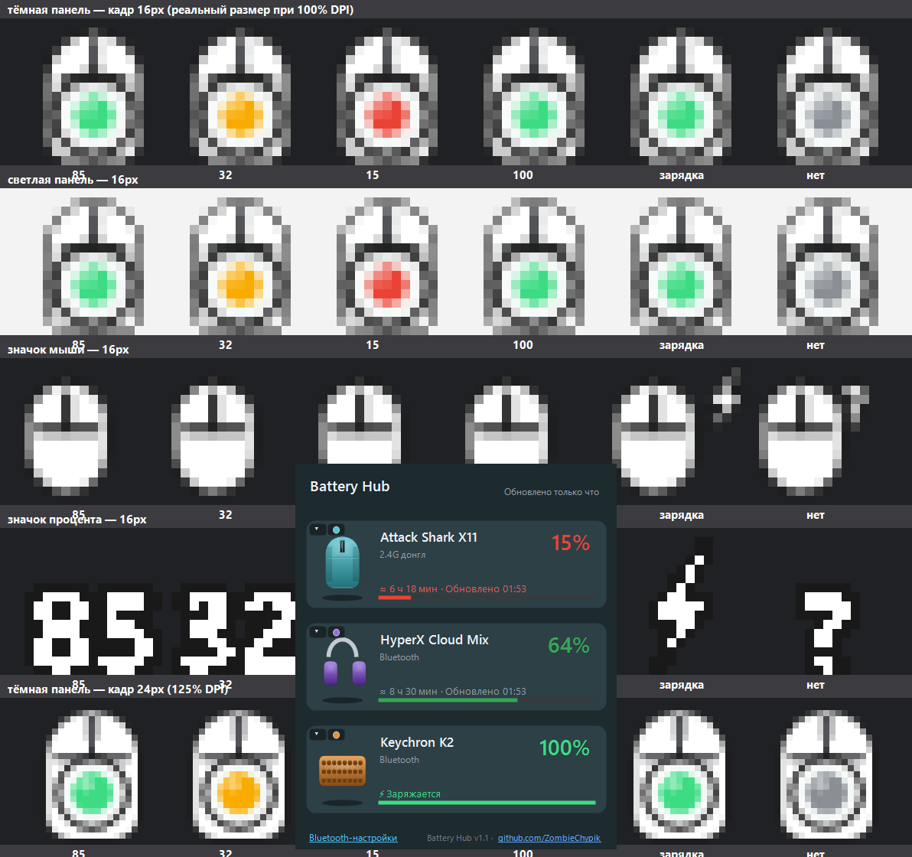

# Battery Hub

Заряд беспроводных устройств прямо на панели задач Windows.



## Что это

Маленький хаб (один exe, без установки, .NET встроен), который показывает
заряд мыши, клавиатуры, наушников и геймпада рядом с часами:

```
🖱 ●42%   🎧 ●64%   ⌨ ●100%
```

Точка-маркер заряда: 🔴 ниже 20% · 🟡 20–50% · 🟢 выше 50% · ⚫ нет данных.

## Возможности

- **Виджет на панели задач** или **значок в трее** (закрепляется возле РУС/ENG автоматически)
- **Панель устройств** по левому клику: модели, проценты, оценка времени работы,
  сортировка по заряду (больше — выше), прокрутка при большом числе устройств
- **Bluetooth-устройства** — заряд берётся из GATT Battery Service через Windows
- **Attack Shark X11** (и совместимые 2.4G-донглы VID 0x1D57) — заряд читается
  напрямую из HID-отчётов донгла; проводное подключение = «заряжается»
- **Цвет хаба** — палитра + «Другой цвет…» (любой цвет): корпус устройств,
  значок, меню
- **Уведомления** при заряде ниже 20% и 10%
- **Русский / English** интерфейс
- Экономный: пустых опросов нет, при выключенном Bluetooth источник спит,
  панель перерисовывается только при реальном обновлении данных

## Запуск

1. Скачать `BatteryHub.exe` из релиза (или собрать самому — ниже).
2. Запустить. Если Windows покажет «защитила ваш компьютер» —
   «Подробнее» → «Выполнить в любом случае» (exe без подписи сертификата).
3. Виджет появится на панели задач рядом с часами. Автозапуск включится сам.

Настройки и история: `%LocalAppData%\BatteryHub\`
Диагностика: `BatteryHub.exe --probe` → `probe.log` рядом с настройками

Требования: Windows 10 (1903+) или Windows 11.

## Благодарности

Идея и общий принцип работы взяты из проекта
[Wireless-Device-Battery-Monitor](https://github.com/krisgfx9/Wireless-Device-Battery-Monitor)
автора [krisgfx9](https://github.com/krisgfx9) — код здесь написан с нуля
(C#, WinForms, .NET 8), но подход и принцип вдохновлён им.

## О проекте

Battery Hub — хобби-проект, сделанный на чистом энтузиазме и написанный вместе с ИИ.
Никакой коммерции, рекламы и сборщиков данных — просто полезная утилита, которой
не хватало.

**Нашли баг или что-то работает криво — [создайте issue](https://github.com/ZombieChypik/BatteryHub/issues/new),**
по каждой ошибке постараюсь выпустить исправление.

## Планы

- 🎨 Качественные 3D-модели всех типов устройств в панели
- 🔄 Регулярные обновления и доработки функционала

## Сборка из исходников

```
dotnet publish src/BatteryHub -c Release
```

Готовый однофайловый exe появится в `src/BatteryHub/bin/Release/.../publish/`
(или используйте `build.ps1` — он собирает в папку `out`).

## Управление

- Левый клик по виджету/значку — панель устройств (закрытие: «✕» или Escape)
- Правый клик — меню: обновить, отображение, цвет, язык, автозапуск,
  Bluetooth-настройки, выход

## Автор

[github.com/ZombieChypik](https://github.com/ZombieChypik) · сделано с [ZCode](https://zcode.app)
